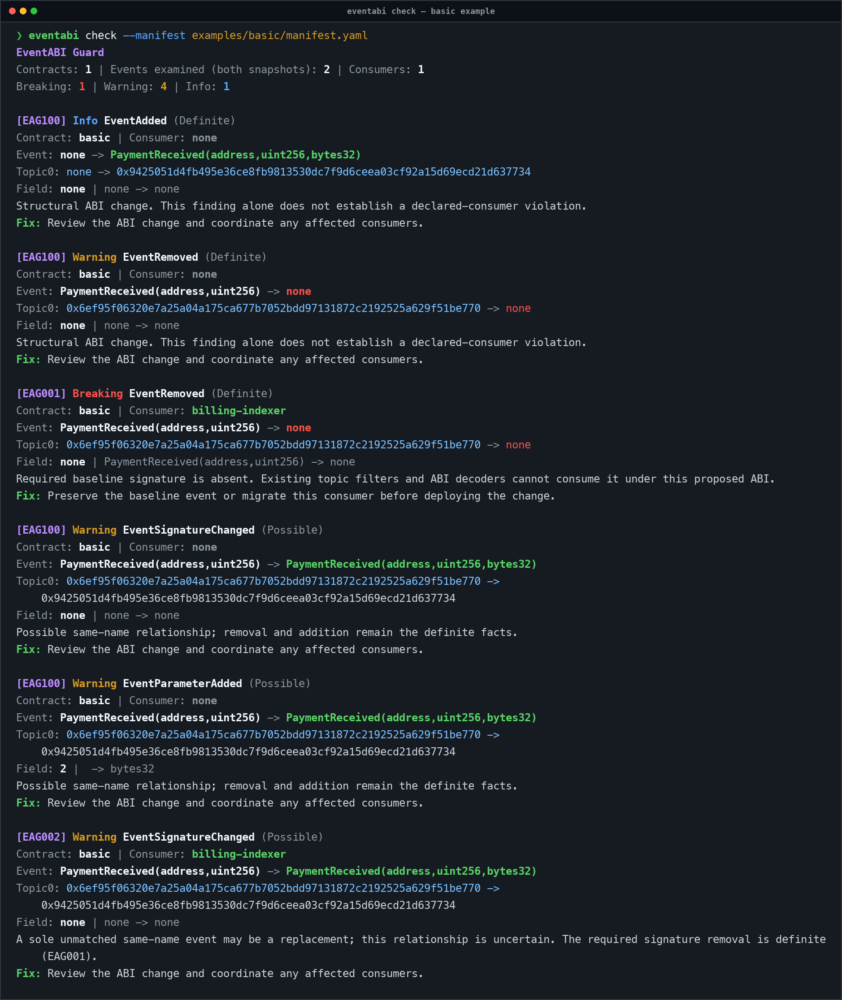
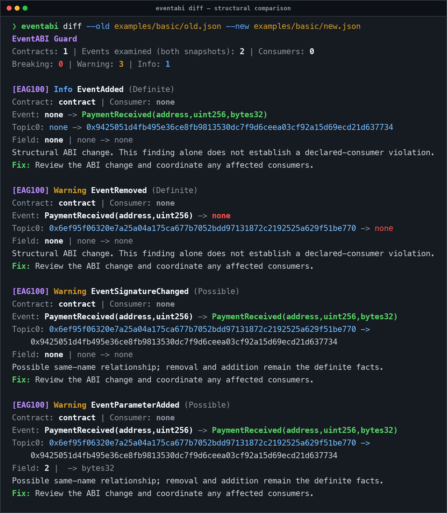
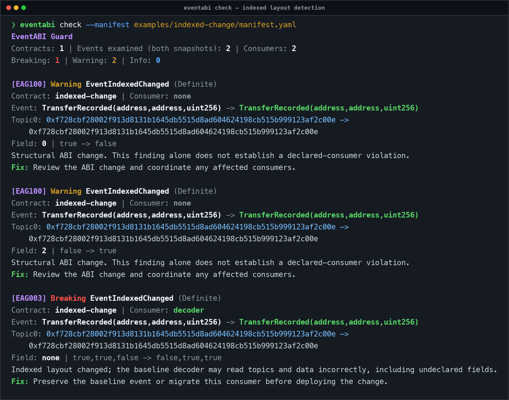
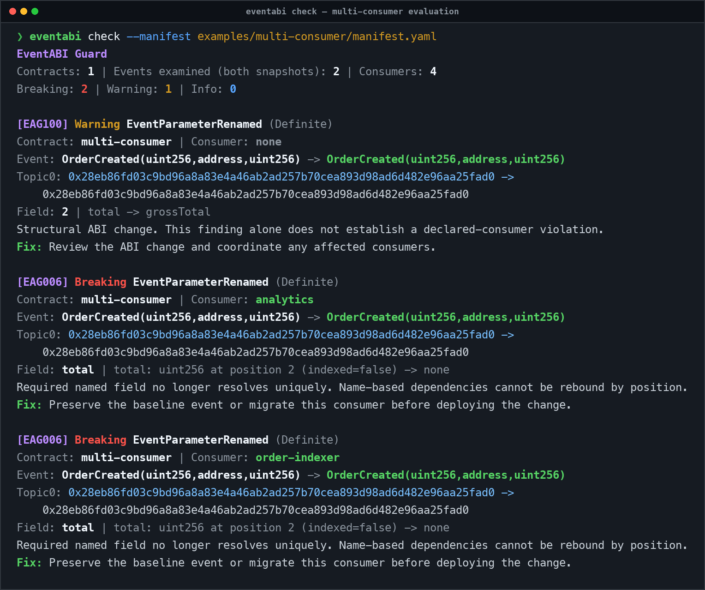
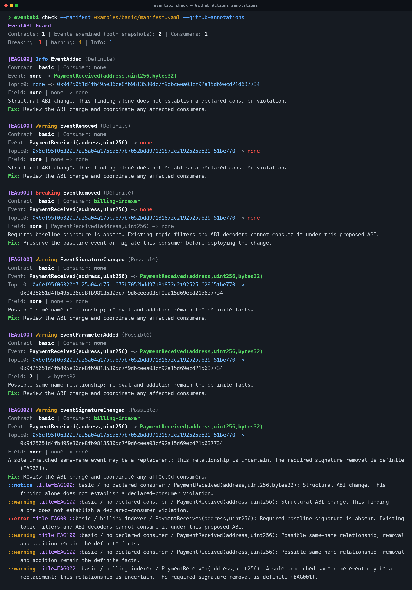

# EventABI Guard

Protect off-chain consumers from breaking smart contract event changes.

[](https://github.com/ranajahanzaib/event-abi-guard/actions/workflows/ci.yml) [](LICENSE) [-orange.svg>)](rust-toolchain.toml)

Smart contract upgrades can preserve every public function while silently breaking indexers, billing services, analytics pipelines, and event subscribers. **EventABI Guard** compares two contract event ABIs against the exact expectations declared for each off-chain consumer. It works completely offline: no RPC nodes, private keys, compilers, or EVM environments required for existing ABI JSON.


_EventABI Guard checking declared consumers on contract upgrade: catching a breaking event signature removal and topic0 shift before deployment. [View animated session](docs/screenshots/cli-demo.gif)._

---

## The Problem

Smart contract events are the primary communication bridge between on-chain state transitions and off-chain infrastructure (The Graph subgraphs, payment indexers, webhook relays, Kafka pipelines, and monitoring bots).

Contract upgrades frequently cause production outages in three distinct ways:

1. **Signature & Topic0 Replacement**: Modifying or appending a parameter changes the canonical signature and Keccak-256 topic0 hash. Subscriptions listening to the original topic cease receiving logs.

   ```solidity
   // Before: topic0 = 0x6ef95f06320e7a25a04a175ca677b7052bdd97131872c2192525a629f51be770
   event PaymentReceived(address indexed payer, uint256 amount);

   // After: topic0 = 0x9425051d4fb495e36ce8fb9813530dc7f9d6ceea03cf92a15d69ecd21d637734
   event PaymentReceived(address indexed payer, uint256 amount, bytes32 referenceId);
   ```

2. **Silent Indexed Layout Shifts**: Toggling an `indexed` modifier does not alter event names or parameter types, but relocates variables between the indexed log topics and unindexed log data bytes. Decoders fail or read corrupt values even when topic0 remains unchanged.
3. **Parameter Renaming**: Subgraph mappings, JSON decoders, and SDK listeners referencing parameter names fail when an input is renamed (e.g. `total` &rarr; `grossTotal`), even though the wire signature and topic0 are identical.

EventABI Guard validates upgrades against explicit consumer expectations, surfacing breaking regressions, structural warnings, and actionable remediation before code merges.

---

## Key Features

- **Input Agnostic**: Parses raw JSON ABI arrays and Foundry/Hardhat compiler artifacts containing `abi`. Extra compiler metadata is safely ignored.
- **Strict ABI Specification**: Supports canonical Solidity event signatures, Keccak-256 topic0, tuples, multi-dimensional fixed/dynamic arrays, overloads, and anonymous events.
- **Consumer-Specific Evaluation**: Model consumers as `decoded` (requiring full layout and fields) or `topic_only` (filtering on topic0 alone).
- **Flexible Field Binding**: Bind expectations by parameter name, zero-based position, or both. Positional consumers survive renames; named consumers enforce API stability.
- **Separation of Certainty**: Distinguishes between definite removals/additions and heuristic same-name candidate matches. Overloads are never ambiguously guessed.
- **Multi-Format Reporting**: Outputs human-readable terminal text, versioned JSON Schema v1, GitHub Flavored Markdown, and escaped GitHub Actions workflow annotations.
- **Deterministic & Offline**: Stable Keccak-256 finding IDs, zero timestamp drift, no network calls, bounded memory limits (16 MiB per input), and strict exit codes for CI/CD gates.

---

## Visual Demonstration Gallery

| Workflow                                                                                                                                                                      | Demonstration                                                                                            |
| ----------------------------------------------------------------------------------------------------------------------------------------------------------------------------- | -------------------------------------------------------------------------------------------------------- |
| **Breaking Consumer Check**<br>Detects missing signature `PaymentReceived(address,uint256)` and identifies declared consumer failure (`EAG001`).                              | [](docs/screenshots/overview.png)                   |
| **Structural ABI Diffing**<br>Compares baseline and proposed ABI directly without a manifest; surfaces structural additions, removals, and candidate replacements (`EAG100`). | [](docs/screenshots/diff-mode.png)                |
| **Silent Indexed Layout Shift**<br>Topic0 remains identical (`0xf728...`); topic subscriber passes while decoded indexer breaks on topic/data realignment (`EAG003`).         | [](docs/screenshots/indexed-layout.png) |
| **Named vs Positional Consumers**<br>Field `total` renamed to `grossTotal`. Named consumers fail (`EAG006`), while positional decoders and monitors pass safely.              | [](docs/screenshots/multi-consumer.png) |
| **CI / GitHub Actions Annotations**<br>Emits escaped workflow commands (`::error title=EAG001::...`) to stderr while keeping JSON stdout pure for automation.                 | [](docs/screenshots/ci-annotations.png) |

_An animated capture of the terminal interaction is also available at [docs/screenshots/cli-demo.gif](docs/screenshots/cli-demo.gif)._

---

## Installation

Install current stable Rust (using [rustup](https://rustup.rs/)), then build or install from source:

```bash
# Build optimized release binary
cargo build --release --locked

# Verify binary
./target/release/eventabi --version
# Output: eventabi 0.1.0

# Optional: install binary into ~/.cargo/bin
cargo install --path . --locked
```

The CLI executable is `eventabi`; the reusable Rust library is `eventabi_guard`. Analysis runs completely offline with no network or daemon requirements.

---

## Quick Start

The repository includes runnable test suites and fixtures under `examples/`:

```bash
# 1. Structural diff between two ABIs (exit 0; warnings describe potential risk)
eventabi diff --old examples/basic/old.json --new examples/basic/new.json

# 2. Check declared consumers against a proposed change (exit 1 on breaking change)
eventabi check --manifest examples/basic/manifest.yaml

# 3. Compatible event addition (exit 0)
eventabi check --manifest examples/compatible/manifest.yaml

# 4. Detect silent indexed flag changes (exit 1)
eventabi check --manifest examples/indexed-change/manifest.yaml

# 5. Validate manifest syntax and baseline expectations without policy enforcement (exit 0)
eventabi validate --manifest examples/basic/manifest.yaml
```

---

## Consumer Manifest

Declare your smart contracts and consumer dependencies in a version-1 YAML manifest:

```yaml
version: 1
contracts:
  - id: Payments
    old: old.json # Resolved relative to manifest directory
    new: new.json
consumers:
  - id: billing-indexer
    description: Ingests successful payments into accounting database
    contract: Payments
    events:
      - signature: PaymentReceived(address,uint256)
        mode: decoded
        fields:
          - name: payer
            type: address
            indexed: true
          - position: 1
            type: uint256
  - id: payment-monitor
    description: Slack alert bot listening for payment topics
    contract: Payments
    events:
      - signature: PaymentReceived(address,uint256)
        mode: topic_only
```

### Dependency Modes

- **`decoded`**: Assumes consumer decodes the log payload using the full event ABI. Any missing signature, anonymous status toggle, or indexed layout change is treated as breaking, even if unlisted fields change.
- **`topic_only`**: Subscribes solely by filtering topic0. Requires a non-anonymous event and empty `fields`. Survives parameter renames, layout shifts, and field changes as long as canonical topic0 matches.

### Field Assertions

- **`name` alone**: Decoded parameter must exist with identical canonical type and position. Fails on parameter renaming.
- **`position` alone**: Positional slot is required; parameter name is informational. Survives renaming if type and position are preserved.
- **Both `name` and `position`**: Parameter must preserve both its identifier and positional index.
- **Tuple fields**: Named tuples recursively validate the names and positions of their components.

See [docs/manifest.md](docs/manifest.md) for full manifest specification.

---

## Compatibility Rules

Rules are assigned stable identifier codes:

| ID         | Severity           | Description                                                                                                                      |
| ---------- | ------------------ | -------------------------------------------------------------------------------------------------------------------------------- |
| **EAG001** | `breaking`         | Required baseline signature absent from proposed ABI. Adding or modifying parameters changes topic0.                             |
| **EAG002** | `warning`          | Sole unmatched same-name event suggested as a candidate replacement. Certainty is `possible`; EAG001 remains the definite break. |
| **EAG003** | `breaking`         | `indexed` modifier changed on an input for a `decoded` consumer, altering binary topic/data layout.                              |
| **EAG004** | `breaking`         | Required field no longer resolves and cannot be matched by position or type.                                                     |
| **EAG005** | `breaking`         | Required field resolved to a different canonical ABI type.                                                                       |
| **EAG006** | `breaking`         | Required parameter name changed at position, or nested tuple component names changed.                                            |
| **EAG007** | `breaking`         | Required field moved to a different index within an otherwise unchanged signature.                                               |
| **EAG008** | `breaking`         | `anonymous` flag changed for an event, changing emitted topic count and layout.                                                  |
| **EAG100** | `warning` / `info` | Structural ABI change without a declared consumer violation (additions are `info`; removals/modifications are `warning`).        |

See [docs/compatibility-rules.md](docs/compatibility-rules.md) for detailed certainty semantics.

---

## CLI Reference

```text
eventabi diff --old <PATH> --new <PATH> [OPTIONS]
eventabi check --manifest <PATH> [OPTIONS]
eventabi validate --manifest <PATH>

Output Options:
  --format <human|json|markdown>      Output format for stdout (default: human)
  --json-out <PATH>                   Write formatted JSON report to file
  --markdown-out <PATH>               Write GitHub Flavored Markdown report to file
  --github-annotations               Emit escaped workflow commands to stderr
  --fail-on <breaking|warning|never>  Failure threshold for exit code 1 (default: breaking)
  -h, --help                          Print command help
  -V, --version                       Print version
```

### Exit Codes

- **`0`**: Success. Inputs are valid and findings satisfy the configured `--fail-on` policy.
- **`1`**: Policy failure. Findings violated `--fail-on` threshold (e.g. breaking consumer violation detected).
- **`2`**: Invalid input, file access error, malformed ABI, or invalid manifest configuration.

### CI Integration Example

```bash
eventabi check --manifest .eventabi/manifest.yaml \
  --format json \
  --json-out eventabi-report.json \
  --markdown-out eventabi-report.md \
  --github-annotations
```

See [docs/report-schema.md](docs/report-schema.md) for JSON schema documentation and [docs/ci-integration.md](docs/ci-integration.md) for a copyable GitHub Actions workflow.

---

## Example Suite

Committed test fixtures in `examples/`:

| Directory                                            | Scenario                                | Expected Exit | What It Demonstrates                                                         |
| ---------------------------------------------------- | --------------------------------------- | :-----------: | ---------------------------------------------------------------------------- |
| [`examples/basic`](examples/basic)                   | Added parameter (`bytes32 referenceId`) |     **1**     | Signature changes; topic0 shifts; `billing-indexer` fails with EAG001.       |
| [`examples/indexed-change`](examples/indexed-change) | Indexed flags swapped                   |     **1**     | Topic0 matches; topic subscriber passes; decoded consumer fails with EAG003. |
| [`examples/multi-consumer`](examples/multi-consumer) | Parameter `total` renamed               |     **1**     | Named consumers break with EAG006; positional decoders & monitors pass.      |
| [`examples/compatible`](examples/compatible)         | Added new event `Paused`                |     **0**     | Backward-compatible addition; reports EAG100 info finding; passes policy.    |
| [`examples/foundry`](examples/foundry)               | Foundry project artifact                |     **1**     | Direct compilation check using `forge build` artifact.                       |

---

## Library Usage

`eventabi_guard` can be embedded directly in Rust tools, indexers, or CI bots:

```rust
use eventabi_guard::{abi, consumer, diff};
use std::path::Path;

// 1. Compare two raw ABI strings or artifacts
let previous = abi::parse(r#"[{"type":"event","name":"Transfer","inputs":[{"name":"from","type":"address","indexed":true}],"anonymous":false}]"#)?;
let proposed = abi::parse(r#"[]"#)?;
let structural_changes = diff::compare_abis(&previous, &proposed);
assert_eq!(structural_changes.len(), 1);

// 2. Load and validate a consumer manifest
let validated = consumer::load(Path::new("examples/basic/manifest.yaml"))?;
let report = consumer::check(&validated);

println!("Breaking violations: {}", report.summary.breaking);
assert!(report.summary.breaking > 0);
# Ok::<(), eventabi_guard::Error>(())
```

---

## Architecture & Design Principles

1. **Deterministic Hashes**: Findings receive reproducible Keccak-256 identifiers derived from canonical properties, ensuring stable tracking across runs.
2. **Strict Type Grammar**: Normalizes standard Ethereum ABI types (`uint`, `int`, aliases, fixed-size and dynamic arrays, nested tuples up to 24 levels deep).
3. **No Phantom Coordinates**: Does not invent source line numbers; emits clear contract/consumer/event contexts for GitHub annotations and Markdown summaries.
4. **Resilient Memory Bounds**: Files are capped at 16 MiB to prevent memory exhaustion from oversized artifacts.

See [docs/architecture.md](docs/architecture.md) and [docs/limitations.md](docs/limitations.md).

---

## Development & Testing

Run the test suite and linters locally:

```bash
# Code formatting
cargo fmt --all -- --check

# Linter checks with strict warnings
cargo clippy --all-targets --all-features -- -D warnings

# Execute full test suite (67 unit, CLI, and integration tests)
cargo test --all-features

# Build release binary
cargo build --release --locked
```

---

## License

This project is licensed under the [MIT License](LICENSE).
